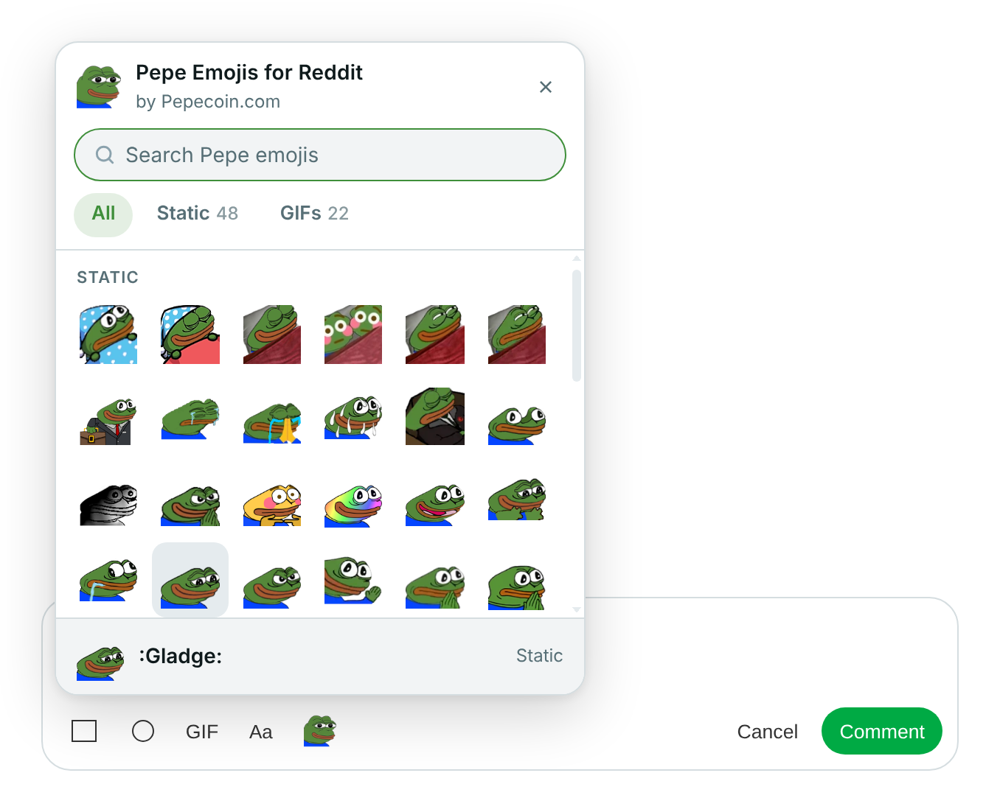
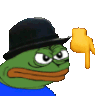

<div align="center">


# Pepe Emojis for Reddit

**A Pepe emoji picker built right into Reddit's comment box.**<br>
Click the Pepe, pick a frog, and it lands in your comment.

<sub>Made with 💚 by <a href="https://pepecoin.com"><b>Pepecoin.com</b></a></sub>

<br>


<br><br>

&nbsp;
&nbsp;
&nbsp;
&nbsp;
&nbsp;
&nbsp;


<br><br>

<picture>
  <source media="(prefers-color-scheme: dark)" srcset="docs/picker-dark.png">
  <source media="(prefers-color-scheme: light)" srcset="docs/picker-light.png">
  
</picture>

<br>

[Install](#install) · [How to use](#how-to-use) · [Add your own Pepes](#add-your-own-pepes) · [Good to know](#good-to-know) · [Privacy](#privacy)

</div>

<br>

##  Features

<table>
  <tr>
    <td align="center" width="33%">
      <br>
      <b>Right in the toolbar</b><br>
      <sub>A Pepe button sits next to <b>Aa</b> in every comment box.</sub>
    </td>
    <td align="center" width="33%">
      <br>
      <b>70 Pepes, two flavors</b><br>
      <sub>48 static and 22 animated, with their own <b>Static</b> and <b>GIFs</b> tabs.</sub>
    </td>
    <td align="center" width="33%">
      <br>
      <b>Find it fast</b><br>
      <sub>Search by name. Press <kbd>Enter</kbd> to drop in the first match.</sub>
    </td>
  </tr>
  <tr>
    <td align="center" width="33%">
      <br>
      <b>Recently used</b><br>
      <sub>Your go-to Pepes stay at the top of the picker.</sub>
    </td>
    <td align="center" width="33%">
      <br>
      <b>Looks native</b><br>
      <sub>Follows Reddit's light or dark theme automatically.</sub>
    </td>
    <td align="center" width="33%">
      <br>
      <b>No servers, no tracking</b><br>
      <sub>Every Pepe ships inside the extension.</sub>
    </td>
  </tr>
</table>

<a name="install"></a>

##  Install

1. **Download** this folder (or unzip `pepe-emoji-extension.zip`) somewhere it can stay.
2. Open <kbd>chrome://extensions</kbd> in Chrome, Edge or Brave.
3. Turn on **Developer mode** (top-right corner).
4. Click **Load unpacked** and choose the `pepe-emoji-extension` folder.
5. Open any post on [reddit.com](https://www.reddit.com) and click into the comment box. Your Pepe is waiting. 

<a name="how-to-use"></a>

##  How to use

<table>
  <tr>
    <td align="center" width="33%">
      <br>
      <b>1. Click the Pepe</b><br>
      <sub>It's right after the <b>Aa</b> button in the comment toolbar.</sub>
    </td>
    <td align="center" width="33%">
      <br>
      <b>2. Pick a frog</b><br>
      <sub>Browse <b>All</b>, <b>Static</b> or <b>GIFs</b>, or start typing to search.</sub>
    </td>
    <td align="center" width="33%">
      <br>
      <b>3. Post it</b><br>
      <sub>The Pepe is attached to your comment. Hit <b>Comment</b>.</sub>
    </td>
  </tr>
</table>

> [!TIP]
> **Keyboard shortcuts:** <kbd>Enter</kbd> picks the first result · <kbd>↓</kbd> jumps into the grid · <kbd>Tab</kbd> moves between Pepes · <kbd>Esc</kbd> closes the picker

##  What's inside

```text
pepe-emoji-extension/
├── manifest.json          Extension settings (Manifest V3)
├── content.js             Toolbar button, picker and comment insertion
├── emojis/
│   ├── static/            Static Pepes (.png, .jpg, .webp)
│   ├── gif/               Animated Pepes (.gif)
│   └── index.json         List of every emoji the picker shows
├── icons/                 Pepe button and extension icons
├── docs/                  Screenshots for this README
└── tools/
    └── build_index.py     Rebuilds emojis/index.json
```

<a name="add-your-own-pepes"></a>

##  Add your own Pepes

1. Drop image files into the right folder:
   - **Static** → `emojis/static/` &nbsp;<sub>(png, jpg or webp)</sub>
   - **Animated** → `emojis/gif/` &nbsp;<sub>(gif)</sub>

   The file name becomes the emoji's name and search term, so `PepeLaugh.gif` shows up as `:PepeLaugh:`.
2. Rebuild the emoji list:

   ```bash
   python3 tools/build_index.py
   ```

3. Click the reload ↻ icon on the extension in <kbd>chrome://extensions</kbd>, then refresh Reddit.

> [!NOTE]
> Chrome extensions can't list their own folders, so the picker reads `emojis/index.json`. If a new Pepe doesn't appear, the list probably wasn't rebuilt.

<p>
 <sub>Tip: Pepes with transparent backgrounds look best on both light and dark Reddit. Square images around 112 × 112 px work well.</sub>
</p>

<a name="good-to-know"></a>

##  Good to know

> [!IMPORTANT]
> Reddit only shows images in comments where a community allows **images or GIFs in comments**. Anywhere else, the picker shows a notice instead of failing silently. For static Pepes, it also copies the image to your clipboard.

- Pepes are posted as **image attachments**, the same as pasting a picture. They aren't inline text emoji. True inline emojis are a community feature that moderators set up in Reddit's mod tools.
- Works on **new Reddit** (`www.reddit.com`). Old Reddit doesn't support images in comments.

<details>
<summary><b>How it works under the hood</b></summary>
<br>

- The content script finds the comment box's **Show formatting options** button, even inside Reddit's shadow-DOM components. It then adds the Pepe button in its own `rte-toolbar-button` right after it.
- When you pick a Pepe, the file goes to Reddit's own image-upload path. It tries a **paste** first, then **drag-and-drop**, then Reddit's **image-upload input**, and stops as soon as one works.
- The picker runs in its own shadow root, so its styles never clash with Reddit's.

</details>

<details>
<summary><b>Troubleshooting</b></summary>
<br>

| Problem | Try this |
| --- | --- |
| No Pepe button in the toolbar | Refresh the Reddit tab after installing or reloading the extension. |
| "Reddit didn't accept the image here" | That community doesn't allow images in comments. Try a community that does. |
| A new emoji is missing | Run `python3 tools/build_index.py`, reload the extension, then refresh Reddit. |
| Button sits in an odd spot | Reddit may have changed its toolbar. Right-click **Aa**, choose **Inspect** and share a screenshot when you report it. |

</details>

<a name="privacy"></a>

##  Privacy

No accounts, no analytics and no outside servers. Every Pepe is bundled with the extension.

| Permission | Why it's needed |
| --- | --- |
| `reddit.com` site access | Adds the Pepe button to Reddit's comment box. |
| `storage` | Remembers your recently used Pepes, on your device only. |
| `clipboardWrite` | Copies a static Pepe to your clipboard when a community blocks images. |

<br>

<div align="center">

&nbsp;
&nbsp;
&nbsp;
&nbsp;


**Pepe Emojis for Reddit** · Made with 💚 by [Pepecoin.com](https://pepecoin.com)

<sub>Not affiliated with or endorsed by Reddit, Inc. Pepe the Frog was created by Matt Furie.</sub>

</div>
